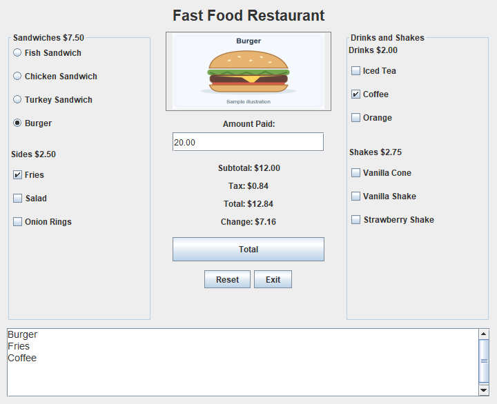

# Ameer AZ | Computer Science Projects

I'm a computer science student working with Java, desktop interfaces, and data structures. This portfolio brings together maintained versions of my coursework, with small reference exercises kept in their own folder.

**[Selected projects](#selected-projects)** · **[Code guide](docs/CODE_GUIDE.md)** · **[Full catalog](CATALOG.md)** · **[Validation](VALIDATION.md)**

## Selected projects

| Project | What you can try | What the code demonstrates |
| --- | --- | --- |
| **[Phone Directory](java/applications/phone-directory/)** | Add, find, update, remove, and sort contacts in a console menu. | Objects, `ArrayList`, input normalization, searching, and sorting. |
| **[Restaurant Order Calculator](java/applications/fast-food-order-calculator/)** | Choose an order, see its price and tax, enter payment, and calculate change. | Swing events, interface state, integer-cent arithmetic, and input validation. |
| **[Java Data Structures](java/algorithms/)** | Partition integers, validate nested delimiters, list unique courses, and tally votes. | Stacks, queues, `TreeSet`, `HashMap`, and file parsing. |
| [Student Information Browser](java/applications/student-information-browser/) | Navigate a small set of read-only sample records. | Separate data, interface, and startup classes; navigation boundary states. |

## A look at the interface

[](java/applications/fast-food-order-calculator/)

The current restaurant app, running with synthetic demo input and generic menu illustrations. Its README explains the current calculation behavior and how it differs from the original submission.

The [student browser](java/applications/student-information-browser/) also includes a screenshot. For a console example, see the [captured phone-directory session](docs/demos/phone-directory.txt).

## Try a project

The programs use the Java standard library. The launcher needs **JDK 17+** and **Python 3.9+**. Current execution checks used **JDK 21 on Windows**; Swing programs need a desktop session.

```sh
git clone https://github.com/Alyzzini/computer-science-projects.git
cd computer-science-projects
python tools/projects.py run applications/phone-directory
```

To try the desktop calculator or a data-structure example:

```sh
python tools/projects.py run applications/fast-food-order-calculator
python tools/projects.py run algorithms/delimiter-validation
```

Run the included console examples, or compile the complete Java collection:

```sh
python tools/check_examples.py
python tools/projects.py build all
```

Use `python tools/projects.py list` for every Java project ID. If Java is not on your command path, put `--java-home PATH_TO_JDK` before the launcher's command. Some project pages also show how to build and run directly with Java.

## Where to look in the code

- **Collections and search:** [PhoneDirectory.java](java/applications/phone-directory/src/PhoneDirectory.java)
- **Events and calculation state:** [FastFoodRestaurant.java](java/applications/fast-food-order-calculator/src/FastFoodRestaurant.java)
- **A stack algorithm:** [delimiter validator](java/algorithms/delimiter-validation/src/Main.java)
- **Objects and interface separation:** [student browser classes](java/applications/student-information-browser/src/)

The [code guide](docs/CODE_GUIDE.md) points to the main methods and explains the design choices and limits.

## Scope

These are learning projects: the directory keeps contacts in memory, the record browsers do not edit a database, and the restaurant app calculates an order without processing payments. Sample contact and account data are fictional.

The [full catalog](CATALOG.md) includes all 33 Java programs, three MARIE exercises, and the cache example. Reconstructed dependencies and added reference exercises are identified in their project notes. [Validation notes](VALIDATION.md) distinguish the included example checks from the broader recorded checks. The Marathon teaching fixture has a separate [attribution note](java/foundations/marathon/ATTRIBUTION.md).
