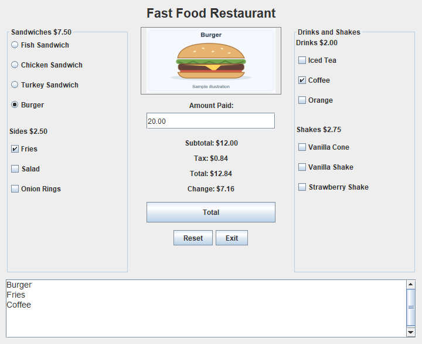

# Fast Food Order Calculator

A Java Swing calculator for building a small menu order and checking the change due. Choose a sandwich, add sides or drinks, and enter a payment amount. This is a maintained coursework project.



Actual application render: Burger + Fries + Coffee totals **$12.84**; a **$20.00** payment gives **$7.16** change. The menu artwork is a generic sample illustration.

## Run

From the repository root, with Python 3.9+ and JDK 17+ available:

```sh
python tools/projects.py run applications/fast-food-order-calculator
```

A desktop session is required. The launcher builds the code and copies the image resources. See the [repository setup instructions](../../../README.md#try-a-project) to select a JDK explicitly.

## Try it

1. Select **Burger**, **Fries**, and **Coffee**. The summary should list all three; subtotal is $12.00, tax is $0.84, and total is $12.84.
2. Enter `20.00` in Amount Paid and click **Total**. Change should be $7.16.
3. Change a selection or edit the payment. The previous change is cleared until payment is calculated again.
4. Try a payment below the total or with more than two decimal places. The program should show an error instead of completed change.
5. Click **Reset** to restore the chicken sandwich with no extras and a blank payment.

## Design and tradeoffs

The implementation is in [FastFoodRestaurant.java](src/FastFoodRestaurant.java).

- **Money:** menu prices use integer cents. `subtotalCents()` totals selections, and `totalCents()` applies 7% tax with half-up rounding once on the subtotal. `BigDecimal` parses payment and formats money without introducing binary floating-point rounding.
- **Event-driven state:** selection listeners call `updateOrderBox()`, which refreshes the text and monetary labels. A payment-field document listener invalidates old change when the amount changes.
- **Interface:** `BorderLayout` and `BoxLayout` organize the panels; a button group allows one sandwich while checkboxes allow multiple extras. `showPicture()` loads classpath resources and handles a missing image.
- **Small scope:** prices and choices live in the same class as the interface. That is easy to follow for this exercise; a larger ordering system would need a separate order model and configurable menu data.

## Scope and maintenance

One fixed-price order is supported, with no quantities, saved orders, inventory, or payment processing. Tax is fixed at 7%. Payments must be sufficient, no more than $1,000,000, and have at most two decimal places.

In the original coursework, the selected-item summary updated automatically while monetary totals required the **Total** button. This maintained version also updates monetary totals on selection changes, checks payment, clears stale change, and uses integer cents. The four bundled illustrations replace missing images and are not product photographs.

[Validation notes](../../../VALIDATION.md) describe the recorded runtime checks and their limits.

<details>
<summary>Build directly without the launcher</summary>

From this project folder, using a JDK:

PowerShell:

```powershell
New-Item -ItemType Directory -Path build -Force | Out-Null
javac -proc:none -encoding UTF-8 -d build src/FastFoodRestaurant.java
java -cp "build;resources" FastFoodRestaurant
```

macOS/Linux shell:

```sh
mkdir -p build
javac -proc:none -encoding UTF-8 -d build src/FastFoodRestaurant.java
java -cp "build:resources" FastFoodRestaurant
```

</details>

[Back to the project index](../../../README.md)
