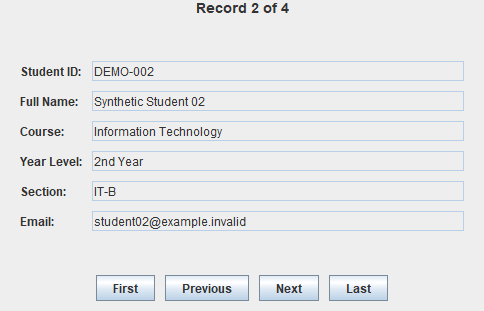

# Student Information Browser

A read-only Java Swing browser for a small student roster. It shows one record at a time, with navigation buttons and a position indicator. This maintained coursework project uses four fictional student records.



Actual application render after clicking **Next**: record 2 of 4, with all navigation buttons available. Names and IDs are synthetic, and email addresses use the non-deliverable `example.invalid` domain.

## Run

From the repository root, with Python 3.9+ and JDK 17+ available:

```sh
python tools/projects.py run applications/student-information-browser
```

A desktop session is required. The launcher compiles all three classes together. See the [repository setup instructions](../../../README.md#try-a-project) to select a JDK explicitly.

## Try it

1. Start on record 1 of 4. **First** and **Previous** should be disabled.
2. Click **Next** to reach the record shown above. Check that all six fields and the position indicator change together.
3. Click **Last**. **Next** and **Last** should now be disabled.
4. Use **Previous** and **First** to navigate back. The displayed fields remain read-only.

## Design and tradeoffs

| Source | Responsibility |
| --- | --- |
| [Student.java](src/Student.java) | Holds six private final string fields, initialized by the constructor and exposed through getters. |
| [StudentInformationFrame.java](src/StudentInformationFrame.java) | Owns the record list, current index, form layout, and navigation events. |
| [StudentInformationApp.java](src/StudentInformationApp.java) | Creates the window on Swing's event-dispatch thread. |

- `showStudent()` updates the fields and record-position label together; `setButtonState()` reflects whether backward or forward navigation is possible.
- `GridBagLayout` aligns the form, while `BorderLayout` and `FlowLayout` place the status and navigation controls.
- The record model is separate from the interface, while navigation stays in the frame. This keeps a small read-only browser easy to follow without introducing an extra controller layer.

## Scope and maintenance

The four records are defined in the source. There is no add, edit, delete, search, or persistence feature; this is a browser rather than a complete student-management system.

The original coursework already separated the model, entry point, and interface and provided record navigation. This maintained version replaces the sample personal details with synthetic records and adds defensive handling for empty collections and invalid record indexes.

[Validation notes](../../../VALIDATION.md) describe the recorded runtime checks and their limits.

<details>
<summary>Build directly without the launcher</summary>

From this project folder, using a JDK:

PowerShell:

```powershell
New-Item -ItemType Directory -Path build -Force | Out-Null
javac -proc:none -encoding UTF-8 -d build src/Student.java src/StudentInformationApp.java src/StudentInformationFrame.java
java -cp build StudentInformationApp
```

macOS/Linux shell:

```sh
mkdir -p build
javac -proc:none -encoding UTF-8 -d build src/Student.java src/StudentInformationApp.java src/StudentInformationFrame.java
java -cp build StudentInformationApp
```

</details>

[Back to the project index](../../../README.md)
